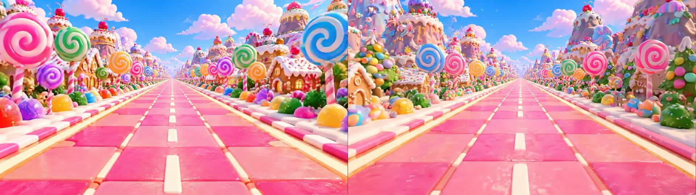
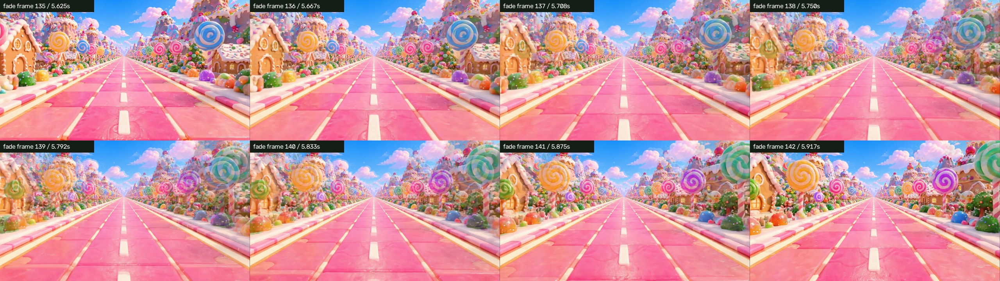
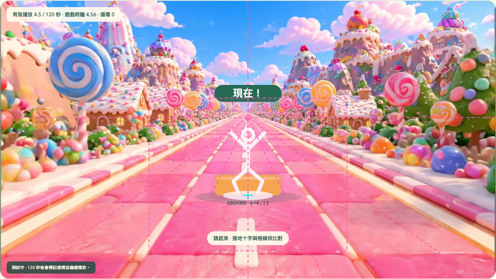

# 棒棒糖森林大道：Phase 1 背景整合測試

日期：2026-10-31。素材狀態：**candidate，尚未核准為正式背景**。

> 本報告保留初版素材與當時測試結果，舊入口／指令不代表目前版本。最新製作基準為 [背景規格 v2.0](BACKGROUND_VIDEO_SPEC.md)，三線道修正版與離線淡化比較見 [目前比較說明](FADE_COMPARISON.md)。本報告的 120 秒結果不能代替新淡化影片的獨立長測與裝置驗收。

## 結論

這支影片適合繼續進行 Phase 1 工程合成測試，但目前不適合宣稱為無縫循環的正式素材。中央道路持續向前、沒有玩法障礙，透視可透過候選參數改善；主要未解問題是首尾環境不連續、原生循環接點有短暫影格間隔，以及影片的內部分隔線更像四個區帶。

短時間交叉淡化降低了硬切程度，卻產生糖果、建築與部分地面紋理的重影／溶解，因此沒有自動採用為正式版本，也沒有建立多影片轉場系統。

## 重現方式

```bash
npm ci
npm run dev
```

首頁點「影片整合測試」，或開啟 `/shape-quest/?videoTest=1`。可選原片、接點剪輯、剪輯＋短淡化，選幾何草案後按「開始 120 秒測試」。達標後會繼續播放，工程單輪上限為 10 分鐘。暫停／恢復、四種方向鍵動作、格線與接地十字均可用；改變幾何會重開一輪，以免混合不同設定的數據。

```bash
npm run build
npx playwright install chromium
npm run test:video
```

`test:video` 逐支以真正 1.0x 速度播放至少 120 秒，不使用虛擬時間或加速。結果寫入 [素材測試目錄](video-tests/l03-candy-001/)，測試輸出獨立於一般 E2E 的目錄，避免清理衝突。建議執行期間不要同時跑其他瀏覽器／模型測試。

## 素材與衍生版本

| 版本 | 內容 | 實際影格／片長 | 音訊 |
| --- | --- | --- | --- |
| 原片 | 使用者提供的 Google Flow 棒棒糖森林大道，原檔保留 | 190 影格；影像 7.9167 秒，容器 7.930 秒 | 有 AAC，播放器強制靜音 |
| 接點剪輯 | 保留原片第 21～171 影格（含），即 0.875～7.1667 秒的半開區間 | 151 影格／6.2917 秒 | 已移除 |
| 剪輯＋短淡化 | 以上剪輯片以約 8 影格／0.333 秒的循環淡化離線烘焙 | 143 影格／5.9583 秒 | 已移除 |

三支都是 1280×720、24 FPS、H.264 / yuv420p。衍生檔使用 `+faststart`；它們只供比較，不覆蓋原片。淡化發生在素材檔內，執行期仍然只有一個 HTML5 Video。

- [原片](../public/videos/level-03/l03_candy_001.mp4)
- [接點剪輯](../public/videos/level-03/l03_candy_001_trim.mp4)
- [短淡化](../public/videos/level-03/l03_candy_001_xfade.mp4)

剪輯接點以保留至少 6 秒、首端及尾端各約 1 秒內的候選影格搜尋，優先降低保守道路遮罩與全畫面的像素差。此方式只是選出可比較的接點，不代表動作或景物已連續。

重建衍生片：先使用選配的 Python + NumPy / OpenCV 環境執行 `scripts/analyze-candy-video.py`，再用已安裝 FFmpeg 的環境執行 `node scripts/prepare-candy-video.mjs`。`scripts/compare-candy-variants.py` 產生接點比較與道路光流估計。這些是離線 QA 工具，不是遊戲執行依賴；現成 MP4 可以直接靜態部署。

## 首尾畫面比較

離線量測使用 640×360 影格，數值為 0～255 的平均絕對像素差（MAE）。道路遮罩為保守的中央路面三角形，不包含大部分兩側景物。不同區域、縮放與色彩轉換會影響數值，不能把 MAE 當成「無縫分數」。

| 版本 | 首尾全畫面 MAE | 首尾道路 MAE | 一般相鄰影格道路 MAE 中位數 |
| --- | --- | --- | --- |
| 原片 | 37.30 | 16.50 | 8.78 |
| 剪輯 | 30.57 | 6.65 | 8.66 |
| 短淡化 | 18.16 | 8.90 | 8.53 |

剪輯讓地面紋理接點更接近，但兩側棒棒糖、建築與雲的排列仍會換位。短淡化的全畫面首尾差較低，然而淡化中段同時出現兩組景物，這是硬切被改成溶解，不是同一個連續 3D 空間。





完整數值：[離線比較](video-tests/l03-candy-001/variant-comparison.json)。接點前後影格亦分別保存在素材測試目錄。

## 120 秒播放器量測

量測以 [`requestVideoFrameCallback`](https://developer.mozilla.org/en-US/docs/Web/API/HTMLVideoElement/requestVideoFrameCallback) 記錄呈現影格、媒體時間回捲、接點間隔與前後縮圖；另記錄 `waiting`、`stalled`、丟影格、獨立遊戲時鐘及失敗判定。`waiting` 在原生 loop 的 seek 過程也可能出現，不等於已證明有網路緩衝。

測試環境為 macOS arm64 上的桌面 Playwright Chromium；每支獨立執行，沒有鏡頭推論，也不是手機／平板驗收。曾嘗試並行播放加其他 E2E，但造成負載及輸出目錄互相干擾，該輪結果排除，正式比較使用序列重跑紀錄。

| 版本 | 非暫停播放秒數 | 循環次數 | 接點間隔範圍／中位數 ms | waiting / stalled | >250ms 間隔 | 丟影格 |
| --- | --- | --- | --- | --- | --- | --- |
| 原片 | 120.55 | 15 | 66.6～116.8／100.0 | 15 / 0 | 0 | 0 |
| 剪輯 | 120.48 | 19 | 66.6～99.9／66.7 | 19 / 0 | 0 | 0 |
| 短淡化 | 120.48 | 20 | 66.6～83.4／66.8 | 20 / 0 | 0 | 0 |

三者均實際達到 120 秒，沒有使用時間加速；接點間隔仍大於單一影格時長。原片接點較長，剪輯／淡化的短停頓有所縮短，但不能把這個差異單獨歸因於剪輯或淡化，因為衍生片也同時移除了音軌、改用 faststart 並重新編碼。

各次紀錄：[原片](video-tests/l03-candy-001/original-120s.json)、[剪輯](video-tests/l03-candy-001/trim-120s.json)、[短淡化](video-tests/l03-candy-001/xfade-120s.json)。每次循環的完整數據與對應素材影格見 [逐次接點紀錄](video-tests/l03-candy-001/LOOP_DETAILS.md)。測試頁可逐列捲動查看現場縮圖；`*-120s.png` 僅保存當時可見的表格區域。

接點間隔應與一般 24 FPS 的約 41.7 ms 比較，不能因為 `stalled = 0` 或沒有超過 250 ms 的停頓就宣稱完全連續。影片本身的景物跳接與播放器短暫等待是兩個不同問題。

## 三線道、接地與滑動

- 前景沿用 `Game`、`Renderer`、`Background`，依獨立遊戲時鐘出題，固定虛擬前進速度。Jump、Duck、左／右 Dodge 都持續出現。
- 障礙與提示使用同一個透視模型，Dodge 的位置取自投影道路的左／右線道中心；不是把整張障礙各自做線性放大。青色十字標出投影地面接觸點，Duck 支柱底端落在同一地面平面。
- 原規格草案 `(0.50, 0.42)`、道路半寬 `0.46` 偏離此片構圖。提供候選 `(0.492, 0.393)`、道路半寬約 `0.63`、虛擬速度 `5.6` 供比對；沒有改動正式遊戲預設，也沒有宣稱已建立 Camera / Motion Profile v1。
- 光流以路面特徵追蹤估計，固定候選消失點下的 `K = dv/dt ÷ (v − horizon)²` 中位數約 `4.61`，10～90 百分位約 `4.42～4.93`；對應 near=2 時虛擬速度約 `5.60`。這只是平面道路與固定相機的近似，不是 AI 影片的真實公尺或相機內參。
- 校正後障礙與地面平均前進速度相近，未見需要以「大幅持續地面滑動」描述的整段反向或橫向滑移；仍有局部光流變化，無法保證每個像素完全鎖定。接點處原片有地紋相位跳變，淡化版則有短暫紋理溶解／滑動感，不能算通過無縫驗收。
- 影片有三條內部分隔線，視覺上更接近四個區帶。程式三線道不能同時與這三條線完全重合；候選校正只是改善消失點、邊界與速度，不會把四區變成三線道。



其他疊圖：[Duck](video-tests/l03-candy-001/duck-overlay.png)、[向左 Dodge](video-tests/l03-candy-001/left-overlay.png)、[向右 Dodge](video-tests/l03-candy-001/right-overlay.png)。120 秒紀錄截圖則使用糖果候選校正參數。

詳細估計：[道路光流](video-tests/l03-candy-001/calibrated-flow.json)。這個估計不取代實際影片合成的視覺與兒童可玩性檢查。

## 暫停、恢復與判定時鐘

工程測試沿用正式 `Game` 的暫停理由、恢復倒數及重新預告行為；僅延長工程測試時長並提高測試生命值，失敗照常累計，不會自動給成功或分數。

暫停時影片與遊戲時間都凍結；恢復先倒數 3 秒，再同步繼續。影片循環或人為 seek 不重設 `Game.time`，碰撞與動作判定不讀 `video.currentTime`。E2E 會在暫停時實際等待、比較兩個時鐘，再將影片 seek 到其他位置，確認遊戲時間不變，恢復後兩者各自繼續。

所有影片透過 `asset()` 與 Vite `BASE_URL` 載入，測試實際在 `/shape-quest/` 下進行。沒有新增後端、遠端影片服務或多播放器系統。

## 需要重生素材的項目

1. **真正可循環的景物配置與地面紋理運動**：目前首尾棒棒糖、建築、雲與地紋不連續；剪輯不能重建缺少的空間，淡化只能遮掩並帶來重影。若要求正式無縫，應重新生成具週期景觀的片段，檢查接點前後多影格的速度與形狀，而非只要求同一張首尾圖。
2. **符合三線道的路面構圖**：生成時改成兩條柔和分隔，或三個材質區塊，避免在中間再加第三條線。這個衝突不能靠 Canvas 調相機參數解決。
3. **更穩定的道路與環境細節**：維持核准消失點、固定高度與視角，避免近景材質變形、雲或裝飾突變，並降低兩側高密度高對比糖果細節對動作提示的干擾。

原生 loop 的短暫 seek／呈現間隔屬播放器與編碼／裝置問題，重新生成 AI 影像不保證解決；須另比較無音軌、faststart、編碼與實機解碼行為。若未來仍需雙播放器預載，另作範圍決策，本次未實作。

## 本次檢查結果

- `npm run test`：25 項通過。
- `npm run build`：型別檢查與正式建置通過。
- `npm run test:e2e`：7 項通過，包含四種障礙疊圖、真實暫停／恢復與 seek 不改遊戲時鐘。
- `npm run test:video`：3 項通過，逐支實際播放 120 秒，共約 6.1 分鐘。
- 手機／平板、真人姿態與遠端 Pages：本次未驗證。

各版本編碼、音軌、大小與 SHA-256 見 [素材 Metadata](video-tests/l03-candy-001/media-metadata.json)。素材未被標記為 Approved。
