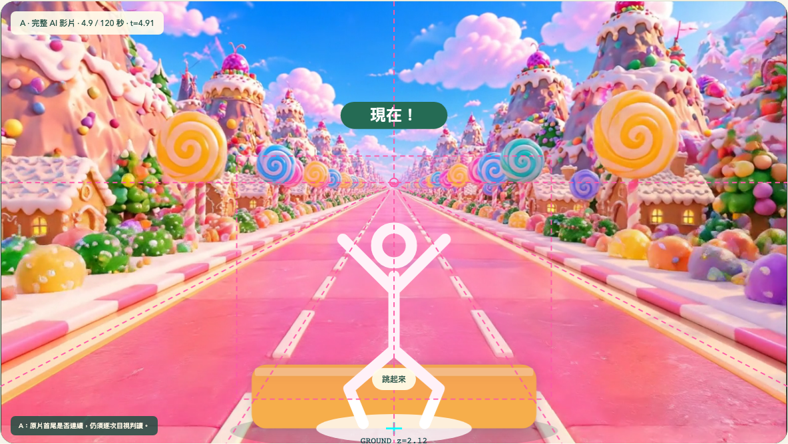
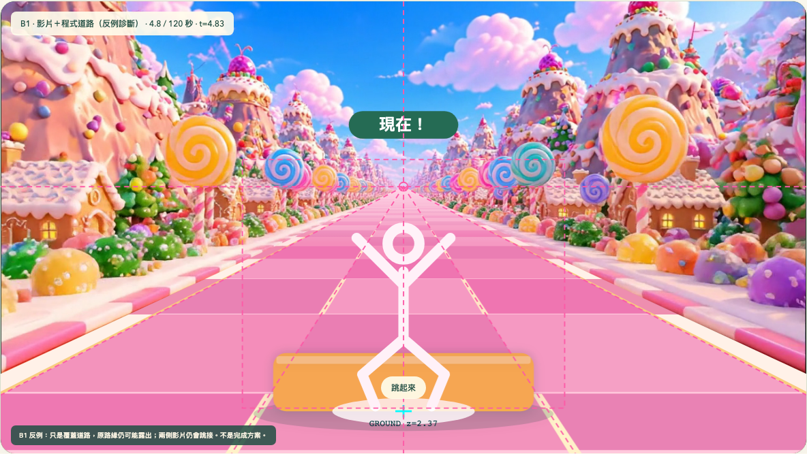
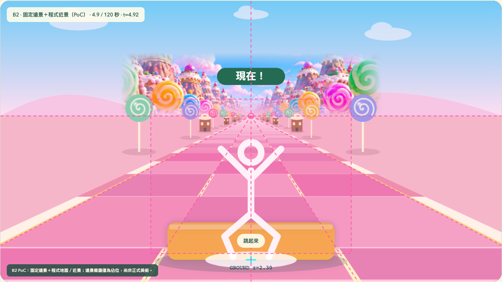

> 歷史研究紀錄：相關實驗程式與專用測試已移除；下列舊頁面、腳本與指令不再提供執行。素材與測試結果保留，目前只維護淡化比較頁 `?videoTest=1`。

# Shape Quest：背景循環與混合式渲染 PoC

日期：2026-11-01。狀態：技術比較；未取代正式背景，未核准任何新素材或正式架構。

## 範圍與操作

沿用 `Game`、Camera Projection、固定虛擬速度、`Renderer`、Debug Overlay、`Background` 及 `VideoMetrics`。新增獨立入口 `/shape-quest/?hybridTest=1`，既有 `/shape-quest/?videoTest=1` 仍保留，並增加前往 PoC 的連結。

```bash
npm ci
npm run dev
```

首頁 → 影片整合測試 → A／B 混合式 PoC。選擇方案、影片來源及共用候選投影，按「開始 120 秒比較」。可切換格線、障礙物、道路遮罩，並檢查最近一次接點的背景前後畫面。切換設定會重開紀錄，避免混合不同設定。

```bash
npm run build
npm run test:hybrid
```

四組以 **1.0x、真實牆鐘時間各至少 120 秒、單一測試頁依序執行**：A v2 原片、A 無音軌／faststart、B1 影片＋程式道路、B2 固定遠景＋程式近景。總長約八分鐘，請與其他 E2E／模型測試分開執行。

所有來源使用 Vite `BASE_URL`，測試實際位於 `/shape-quest/` 專案子路徑。沒有新增執行期套件、後端、影片轉場系統或 AI 生成請求。原始 v1、v2、參考圖、舊剪輯與淡化片都保留；沒有修改正常遊戲預設、MediaPipe 初始化、校正及動作辨識邏輯。

## 實際比較的三個視圖

| 視圖 | 實作 | 用途與限制 |
| --- | --- | --- |
| A 完整影片 | 單一 HTML5 Video，muted / playsInline / loop / 1.0x；Canvas 只畫障礙與提示 | 保留原有美術整體感，影片內地面及景物都會受到首尾接點影響 |
| B1 影片＋程式道路 | 保留整張影片，在其上畫同投影的道路及路緣 | **刻意保留的反例診斷**：道路可連續，但烘焙路緣、兩種材質與兩側跳接仍存在；不得稱為完成方案 |
| B2 固定遠景＋程式近景 | 影片來源完全卸載；參考圖的中央上部裁圖作固定佔位遠景；地平線以下、道路、路緣、棒棒糖與小屋全部即時繪製 | 不依賴影片循環，近景有連續位移與透視；裁圖羽化、風格落差、固定遠景視差仍未達正式美術品質 |

B2 沒有把完整道路圖靜置於程式道路下方。素材只取原圖 normalized `x=.24～.76, y=.20～.425` 的上半部，保持原始角尺寸，快取為約 665×162 的遠景 plate，再羽化到天空與遠方山丘。原圖的近景道路、路緣、近景建築不參與繪製。這是用既有素材驗證架構的佔位做法，不是可靠的自動去背或正式分層美術。

原圖仍有中景棒棒糖與房屋，並非全部真遠景；將其固定會有視差不完整、裁圖邊界與色光不一致問題。不能以道路連續推論整個畫面自然度已通過。

## 素材檢查與 A 的低成本改善

v2 為 1280×720、24 FPS、190 影格的 H.264 / yuv420p，影像長 7.9167 秒，原容器含 AAC 音軌、長約 7.930 秒。已符合兩條內部分隔線的三線道，中央保持空曠；本次未重做世界美術。

新增 `l03_candy_001_v2_faststart.mp4`：僅以 FFmpeg 複製影像串流、去除音軌與前置容器索引，沒有重新編碼或改寫原檔。它可檢查低成本封裝改善是否縮短原生循環等待，**不能改變兩側景物或地紋的空間連續性**。

離線檢查 v2 首尾全畫面像素差約 36.71，道路約 16.34；一般相鄰影格中位數分別約 14.10、5.62。搜尋較接近的剪輯接點，可把道路差降到約 5.91，但全畫面仍約 30.80，而且片段縮短為約 6.67 秒。這表示地面相位較容易湊近，環境的建築／棒棒糖配置仍接不上。此分析不是「不存在任何更好接點」的數學證明，也不是視覺品質分數。

舊剪輯與短淡化保留在既有測試頁，也可由 PoC 的來源選單載入；沒有再次把淡化列為無縫答案。反向播放會失去持續向前感，拉長停格或用遮擋蓋住每次接點也不等於環境連續，因此未加入。

## 120 秒與效能結果

<!-- BENCHMARK_TABLE -->
| 方案 | 有效秒數 | rAF FPS | rAF P95 ms | JS 提交 P95 ms | 診斷 P95 ms | 影片框架增量 | 影片循環／虛擬標記 |
| --- | --- | --- | --- | --- | --- | --- | --- |
| A v2 原片 | 120.33 | 59.84 | 16.80 | 0.20 | 3.80 | 2853 | 15／0 |
| A 無音軌／faststart | 120.61 | 59.85 | 16.70 | 0.20 | 3.80 | 2884 | 15／0 |
| B1 覆路反例 | 120.48 | 59.94 | 16.70 | 0.50 | 4.50 | 2857 | 15／0 |
| B2 固定遠景／程式近景 | 120.38 | 60.00 | 16.80 | 0.60 | 5.90 | 0 | 0／15 |

| 方案 | 影片接點間隔範圍 ms | waiting／stalled | 丟影格 | 解碼回報延遲 P95 ms（非 CPU） | 略過未就緒讀回 |
| --- | --- | --- | --- | --- | --- |
| A v2 原片 | 83.3～116.7 | 15／0 | 0 | 250.50 | 8 |
| A 無音軌／faststart | 50.0～83.4 | 15／0 | 0 | 250.40 | 8 |
| B1 覆路反例 | 83.3～116.7 | 15／0 | 0 | 250.60 | 7 |
| B2 固定遠景／程式近景 | 無影片 | 0／0 | 0 | 無影片 | 0 |
<!-- /BENCHMARK_TABLE -->

結果顯示：四組桌面畫面更新率都接近 60 FPS，不能據此認定 B2 在所有裝置較快。B2 的程式繪圖提交成本高於 A，但移除了持續影片播放；A 的封裝改善縮短部分接點等待，沒有改變 190 個 H.264 影像封包或修復景物連續性。

量測環境：macOS arm64、Node 24.20.0、桌面 Playwright Chromium，viewport 1280×900、DPR 1，同樣的 Debug 與障礙設定，沒有 MediaPipe 推論。前 17 秒各拍四張障礙截圖，可能影響少數早期影格；沒有其他瀏覽器測試同時執行。

- FPS 來自有效運行期間的 rAF 間隔，不是影片 24 FPS 與遊戲 60 FPS 混用。
- Canvas 時間為 **JS 命令提交時間**，另列背景讀回／像素診斷時間；不包含完整 GPU 執行成本。真實 FPS 仍包含 Debug 的整體負載。
- [`processingDuration`](https://developer.mozilla.org/en-US/docs/Web/API/HTMLVideoElement/requestVideoFrameCallback) 是瀏覽器的解碼處理延遲代理值，**不是 CPU 使用率或完整解碼器 profile**；`decodedFrames` 欄位沿用命名，實際取 [`VideoPlaybackQuality.totalVideoFrames`](https://developer.mozilla.org/en-US/docs/Web/API/HTMLVideoElement/getVideoPlaybackQuality) 的差值（含呈現／丟棄計數），不能當成精密解碼吞吐量。
- B2 的影片 `src` 為 null、暫停、影格計數增量及影格回呼均為 0；因此沒有繼續播放被遮住的影片。
- 沒有直接量測 GPU 記憶體、功耗、溫度或裝置的硬體解碼負載。不能僅因 B2 不播影片就宣稱所有裝置一定更快或更省電。

原生 loop seek 時 `readyState < 2` 或仍在 seeking，診斷不讀取像素，另記 `unavailableReadbacks`，避免把未就緒的透明畫布當成素材黑畫面。初輪影像差數據因此作廢；修正及接點回歸測試後，四組重新各跑 120 秒，最終表格只用重測結果。

資料、每次邊界與截圖：[測試目錄](hybrid-tests/candy-v2/)、[逐次紀錄與前後圖集](hybrid-tests/candy-v2/BOUNDARIES.md)。所有輸出保留候選／PoC 標記。

## 連續性、接地與相對滑動

程式地面不是尺寸與位置各自套 easing。路面格、分隔線、路緣及裝飾以世界座標 Z 投影，統一使用：

```text
z = worldZ − gameTime × worldSpeed
obstacleZ = near + (collisionTime − gameTime) × worldSpeed
```

若給路面標記 `worldZ = near + collisionTime × worldSpeed`，則它與該障礙的地面接觸點完全共用位置及速度。單元測試包含 7.93 秒附近、15.86 秒、120 秒後的連續性、地面格覆蓋、線道寬度與投影一致性。這是程式建構上的不變量；不是對 AI 影片光流的實測「零滑動」。

共用候選 Profile 為 `(centerX=.5, horizon=.41, nearHalfWidth=.64, speed=5.0)`，仍保留原規格 Profile 供切換，沒有設為正式 Camera / Motion Profile v1。v2 的影像光流焦點粗估約 `(0.499,0.407)`，存在生成影片的局部誤差；相近消失點不代表已知真實相機內參。

- **A**：障礙與片內地面的相對速度只能近似對齊。影片接點的地紋跳變、局部形變仍在，不能保證沒有滑動。
- **B1**：程式道路與障礙的相對速度可一致，但原影片的路緣、建築與場景光流不會因此一致；畫面兩側仍回捲。它正是「只蓋一條路不夠」的動態反例。
- **B2**：程式道路、路緣及近景裝飾都以同一世界速度前進，遠處新物件在霧化區出現、近處離開畫面，沒有在第 8 秒重設地面或近景位置。固定 plate 沒有媒體循環；它卻也沒有近景的真實視差，因此只允許放遠景，不能保留巨大近景物體。

B2 的 8 秒邊界是對照原片週期的**虛擬標記**，不是一段八秒影片，也不是影片「循環零次所以通過」。長測實際持續前進超過 120 秒，同時檢查虛擬標記兩側的背景動態；虛擬週期取原片影像的 190/24 秒，不含 AAC 的短尾段。

<!-- CONTINUITY_TABLE -->
| 方案 | 平常道路差中位數 | 邊界道路差中位數 | 平常兩側差中位數 | 邊界兩側差中位數 |
| --- | --- | --- | --- | --- |
| A v2 原片 | 4.88 | 16.06 | 25.37 | 44.71 |
| A 無音軌／faststart | 4.87 | 15.04 | 25.40 | 42.20 |
| B1 覆路反例 | 3.16 | 4.15 | 25.39 | 44.58 |
| B2 固定遠景／程式近景 | 3.21 | 3.13 | 2.06 | 2.22 |
<!-- /CONTINUITY_TABLE -->

路面／兩側／天空的像素差取自障礙繪製前的背景合成，避免把正常障礙出題誤認成影片跳接。匯出的 `regionMeanMAE` 是三區的等權平均，不是全畫面加權平均；比較表使用各區原始差值。像素差只作輔助：一般向前運動也會有差值，低差值仍可能是停格、溶解或錯誤的平面視差，需搭配截圖與可操作頁判讀。

## 畫面自然度：本次不做正式通過宣告

A 的單段美術、材質與光照最一致，但八秒接點打斷世界連續性。B1 的反例保留原路緣外露、路面顆粒／亮度落差、場景跳接及速度不同的風險，不能作正式替代。

B2 改善的是幾何與連續性：目前程式棒棒糖、小屋、道路的細節仍遠少於 AI 畫面，固定遠景裁圖也有羽化痕跡、色光及視差差異。截圖或 FPS 通過都不能當成兒童已覺得自然。**本次尚未核准 B2 的正式美術品質或整體可玩性**。

<!-- SCREENSHOTS -->
| A 完整影片 | B1 覆路反例 | B2 固定遠景／程式近景 |
| --- | --- | --- |
|  |  |  |

各方案的 Jump、Duck、左右 Dodge 疊圖及完整 120 秒截圖皆保存在測試目錄；圖片呈現目前 PoC 美術，不代表正式品質通過。
<!-- /SCREENSHOTS -->

## 暫停、遊戲時鐘與原流程

PoC 沿用 Game 的手動／隱藏暫停理由、恢復三秒倒數與未判定題目重新預告。A、B1 暫停時影片一起停止，B2 的地面／近景停止，恢復後按同一 gameTime 繼續，不以媒體時間重置世界。Jump、Duck、左右 Dodge 都由原有的 Game 與 Renderer 出題與判定。

工程測試時長 600 秒、初始測試生命值 1000，只為避免背景測試因沒有真人作動而很快結束；失敗照常記錄，沒有假成功。正式遊戲仍使用既有的預設時長與生命值，沒有啟用本次 PoC 的渲染器。相機、校正、姿態辨識及追蹤恢復流程均不在本次改動範圍。

## 十二個世界的成本與架構建議

| 指標 | A 全影片 | B1 既有影片覆路 | B2 分層遠景＋程式近景 |
| --- | --- | --- | --- |
| 連續性 | 依賴每支影片／接點品質 | 地面可連續，環境仍跳接 | 沒有有限長影片造成的地面或景物回捲；遠處生成／近處移除需管理 |
| 透視與滑動 | 僅可從影像近似校正 | 兩套地面及景觀速度容易衝突 | 可共用投影、世界速度及遮擋順序 |
| 自然度 | 單段最佳、接點明顯 | 容易暴露材質與路緣不一致 | 需高品質分層素材、統一光色與遠近視差；本次只是佔位 |
| 執行成本 | 影片解碼＋少量 Canvas | 同時付出影片與道路成本 | 省去持續影片播放，但新增道路、裝飾繪圖／圖片記憶體成本 |
| 十二世界維護 | 每世界檢查片長、接點、光流及機型解碼 | 另需逐片處理遮罩與邊界，容易變成例外堆疊 | 幾何與程式共用，逐世界換遠景、材質、道具與色盤 |
| 素材下限 | 至少 12 張參考圖＋12 支可用影片，重拍成本不定 | 同左，再加遮罩／修圖 | 最低 12 張遠景＋程式裝飾；正式品質需更多分層美術 |
| 手機／電視 | 解碼與鏡頭推論競爭資源，仍需實測 | 成本疊加，非優先方案 | 有機會簡化負載與接點，但圖片、draw calls、神經推論及投放延遲都需實測 |

**建議的下一步是針對 B2 製作一個世界的專用分層素材，再做手機／平板實測。不是立即把十二世界或正式遊戲全部改成 B2。** 本次幾何／連續性測試與美術品質結論分開；若新素材與實機通過，再提出正式架構變更供確認。

不預先加入前端框架或繪圖引擎。可先沿用 Canvas 2D 的深度投影；若加上 MediaPipe 後的行動裝置效能不足，依 profiler 再評估 WebGL、sprite atlas、批次繪圖或 Worker，不直接宣稱 WebGL 必定較快。

正式品質的規劃量（非已完成素材）：每世界 1 張遠景、1 張路面材質、2～4 個透明近景道具，約 4～6 張來源圖；12 世界約 48～72 張來源圖，可打包為 12 張道具 atlas＋12 張遠景＋12 張材質。影片不是必需品；若要局部環境動態，可另做低視差的小動畫圖層，但仍需檢查接點。素材費用不以未查證的生成點數或模型價格估算。

具體構圖、尺寸、分層與生成 Prompt 見 [分層素材需求](HYBRID_ASSET_BRIEF.md)。

## 尚未完成與實機限制

- 未做手機／平板持續 120 秒、發熱、耗電、記憶體壓力或與 MediaPipe 同時推論的效能測試。
- 未驗證電視鏡像延遲與六歲兒童對速度、路面對比、提示及重複裝飾的感受。
- 沒有取得 AI 影片的深度、真實幾何、真實相機內參或光照；無法用覆蓋／羽化還原成多層場景。
- B2 目前只有程序裝飾與參考裁圖，不是正式 3D 美術。平面 sprite、固定遠景及簡單陰影仍需專用素材和遮擋設計。
- 本次沒有發布 Pages、改正式背景或完成全產品架構決策。

## 本次驗證

- `npm run test`：34 項單元測試通過。
- `npm run build`：型別檢查與正式建置通過。
- `npm run test:e2e`：19 項通過，涵蓋原遊戲、橫直向校正／追蹤恢復、真正模型初始化、PoC 模式切換、卸載影片、暫停／恢復、有效影格讀回與行動尺寸模擬。
- `npm run test:hybrid`：4 組最終有效影格版本，各實跑至少 120 秒，共約 8.1 分鐘。模型推論及其他 E2E 未與長測同時執行。
- 人工視覺檢查包含動態 PoC 頁、四種障礙疊圖及原生接點的前後圖，不以自動化或像素差取代美術／可玩性驗收。

原始與 faststart 影像的 190 個 H.264 封包雜湊完全相同，來源、大小與 SHA-256 見 [素材紀錄](hybrid-tests/candy-v2/asset-metadata.json)。
