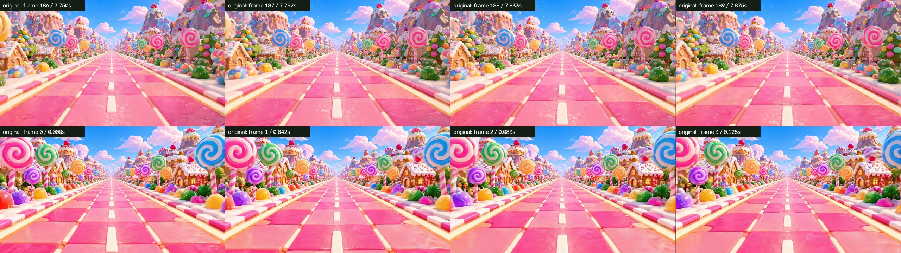
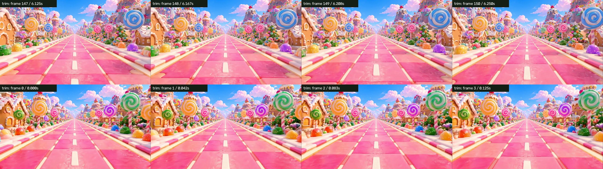
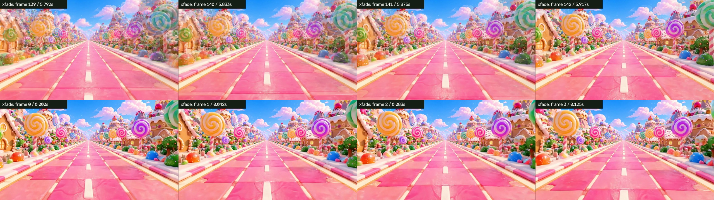

# 逐次循環接點紀錄

這裡列出獨立、真實 1.0x 播放的所有循環。差值為瀏覽器 320×180 影格樣本的 MAE；不是無縫品質分數。每個版本的全部循環都回到相同的媒體影格對，因此影像跳接會規律重複，等待間隔則略有不同。

## 原片

非暫停時間 120.545 秒，遊戲時間 120.546 秒；丟影格 0。

| 循環 | 非暫停秒數 | 媒體時間：前 → 後 | 接點間隔 ms | 全畫面 MAE | 道路 MAE |
| --- | --- | --- | --- | --- | --- |
| 1 | 8.033 | 7.875000 → 0.000000 | 116.8 | 35.87 | 15.93 |
| 2 | 16.049 | 7.875000 → 0.000000 | 116.7 | 35.87 | 15.93 |
| 3 | 24.132 | 7.875000 → 0.000000 | 100.0 | 35.87 | 15.93 |
| 4 | 32.149 | 7.875000 → 0.000000 | 99.9 | 35.87 | 15.93 |
| 5 | 40.165 | 7.875000 → 0.000000 | 100.0 | 35.87 | 15.93 |
| 6 | 48.181 | 7.875000 → 0.000000 | 116.6 | 35.87 | 15.93 |
| 7 | 56.181 | 7.875000 → 0.000000 | 83.4 | 35.87 | 15.93 |
| 8 | 64.281 | 7.875000 → 0.000000 | 116.7 | 35.87 | 15.93 |
| 9 | 72.297 | 7.875000 → 0.000000 | 116.8 | 35.87 | 15.93 |
| 10 | 80.314 | 7.875000 → 0.000000 | 100.0 | 35.87 | 15.93 |
| 11 | 88.313 | 7.875000 → 0.000000 | 83.3 | 35.87 | 15.93 |
| 12 | 96.329 | 7.875000 → 0.000000 | 99.9 | 35.87 | 15.93 |
| 13 | 104.346 | 7.875000 → 0.000000 | 100.1 | 35.87 | 15.93 |
| 14 | 112.362 | 7.875000 → 0.000000 | 100.0 | 35.87 | 15.93 |
| 15 | 120.379 | 7.875000 → 0.000000 | 66.6 | 35.87 | 15.93 |

## 接點剪輯

非暫停時間 120.478 秒，遊戲時間 120.489 秒；丟影格 0。

| 循環 | 非暫停秒數 | 媒體時間：前 → 後 | 接點間隔 ms | 全畫面 MAE | 道路 MAE |
| --- | --- | --- | --- | --- | --- |
| 1 | 6.350 | 6.250000 → 0.000000 | 66.7 | 29.23 | 6.14 |
| 2 | 12.683 | 6.250000 → 0.000000 | 83.3 | 29.23 | 6.14 |
| 3 | 18.999 | 6.250000 → 0.000000 | 83.3 | 29.23 | 6.14 |
| 4 | 25.332 | 6.250000 → 0.000000 | 83.3 | 29.23 | 6.14 |
| 5 | 31.649 | 6.250000 → 0.000000 | 66.7 | 29.23 | 6.14 |
| 6 | 37.982 | 6.250000 → 0.000000 | 66.7 | 29.23 | 6.14 |
| 7 | 44.298 | 6.250000 → 0.000000 | 66.6 | 29.23 | 6.14 |
| 8 | 50.631 | 6.250000 → 0.000000 | 66.6 | 29.23 | 6.14 |
| 9 | 56.948 | 6.250000 → 0.000000 | 83.3 | 29.23 | 6.14 |
| 10 | 63.281 | 6.250000 → 0.000000 | 66.7 | 29.23 | 6.14 |
| 11 | 69.614 | 6.250000 → 0.000000 | 83.3 | 29.23 | 6.14 |
| 12 | 75.930 | 6.250000 → 0.000000 | 83.3 | 29.23 | 6.14 |
| 13 | 82.263 | 6.250000 → 0.000000 | 66.6 | 29.23 | 6.14 |
| 14 | 88.580 | 6.250000 → 0.000000 | 66.7 | 29.23 | 6.14 |
| 15 | 94.913 | 6.250000 → 0.000000 | 66.7 | 29.23 | 6.14 |
| 16 | 101.229 | 6.250000 → 0.000000 | 66.7 | 29.23 | 6.14 |
| 17 | 107.562 | 6.250000 → 0.000000 | 66.6 | 29.23 | 6.14 |
| 18 | 113.895 | 6.250000 → 0.000000 | 99.9 | 29.23 | 6.14 |
| 19 | 120.212 | 6.250000 → 0.000000 | 66.6 | 29.23 | 6.14 |

## 短淡化

非暫停時間 120.478 秒，遊戲時間 120.489 秒；丟影格 0。

| 循環 | 非暫停秒數 | 媒體時間：前 → 後 | 接點間隔 ms | 全畫面 MAE | 道路 MAE |
| --- | --- | --- | --- | --- | --- |
| 1 | 6.016 | 5.916667 → 0.000000 | 66.7 | 16.93 | 8.54 |
| 2 | 12.016 | 5.916667 → 0.000000 | 83.3 | 16.93 | 8.54 |
| 3 | 18.016 | 5.916667 → 0.000000 | 66.6 | 16.93 | 8.54 |
| 4 | 24.016 | 5.916667 → 0.000000 | 83.4 | 16.93 | 8.54 |
| 5 | 29.999 | 5.916667 → 0.000000 | 66.7 | 16.93 | 8.54 |
| 6 | 35.998 | 5.916667 → 0.000000 | 66.7 | 16.93 | 8.54 |
| 7 | 41.998 | 5.916667 → 0.000000 | 83.4 | 16.93 | 8.54 |
| 8 | 47.981 | 5.916667 → 0.000000 | 66.8 | 16.93 | 8.54 |
| 9 | 53.981 | 5.916667 → 0.000000 | 66.7 | 16.93 | 8.54 |
| 10 | 59.981 | 5.916667 → 0.000000 | 83.3 | 16.93 | 8.54 |
| 11 | 65.997 | 5.916667 → 0.000000 | 83.4 | 16.93 | 8.54 |
| 12 | 71.980 | 5.916667 → 0.000000 | 66.7 | 16.93 | 8.54 |
| 13 | 77.980 | 5.916667 → 0.000000 | 83.3 | 16.93 | 8.54 |
| 14 | 83.963 | 5.916667 → 0.000000 | 66.6 | 16.93 | 8.54 |
| 15 | 89.963 | 5.916667 → 0.000000 | 66.7 | 16.93 | 8.54 |
| 16 | 95.946 | 5.916667 → 0.000000 | 83.4 | 16.93 | 8.54 |
| 17 | 101.946 | 5.916667 → 0.000000 | 83.3 | 16.93 | 8.54 |
| 18 | 107.929 | 5.916667 → 0.000000 | 66.7 | 16.93 | 8.54 |
| 19 | 113.929 | 5.916667 → 0.000000 | 83.4 | 16.93 | 8.54 |
| 20 | 119.912 | 5.916667 → 0.000000 | 66.7 | 16.93 | 8.54 |

